# Predicting Crime Rates: When Does Regularisation Matter?

**Benchmarking 10 statistical learning models on a small and a high-dimensional crime dataset in R**


**[▶ View the interactive report](https://sudarshanellora.github.io/crime-rate-prediction/)**

---

## The question

Does the best model for predicting crime depend on how many predictors you have? The same 10 models were fitted to two datasets that differ mainly in dimensionality, and compared test error and training time.

| Dataset | Rows | Predictors | Response |
|---|---|---|---|
| **Boston** (MASS) | 506 | 13 | `crim`, per capita crime rate |
| **Communities and Crime** (UCI) | 1,993 | 100 | `ViolentCrimesPerPop`, violent crimes per 100K population (scaled 0 to 1) |

## Key findings

- **Lasso removed 57 of 100 predictors** on Communities and Crime, and its test error stayed within 5% of OLS on all 100.
- **The best model depends on the data.** Neural networks won on Boston, cutting test error by 63% against OLS. Simple linear models won on Communities and Crime, where an unregularised neural network was **51x worse than OLS**.
- **Regularisation rescued the neural network.** L1 and Elastic Net penalties cut its error on Communities and Crime by about 96%.
- **Switching from `nnet` to `ANN2` made neural network training about 30x faster** on the 100-predictor data: about 5 seconds against 150.

This is the No Free Lunch principle in practice: no single method is best everywhere.

---

## Models

| Family | Variants |
|---|---|
| Linear | OLS, Ridge (L2), Lasso (L1), Elastic Net |
| Support Vector Machine (radial kernel) | Nearly unregularised (C = 1000), L2-regularised with C picked by 10-fold CV |
| Multilayer Perceptron | Unregularised, L2 weight decay (`nnet`), L1 and Elastic Net (`ANN2`) |

L1 and Elastic Net SVMs (`sparseSVM`) only support classification, so they were also run as above/below median crime classifiers.

**Method choices**
- 80/20 train/test split made before any fitting
- Scaling and class thresholds computed from the training set only, so nothing leaks from the test set
- Regularisation strength chosen by 10-fold cross-validation
- Fixed random seeds, and 5 random restarts for `nnet` to avoid poor local minima

## Results

**Test MSE (lower is better)**

| Method | Boston | Communities and Crime |
|---|---|---|
| OLS | 20.07 | **0.0159** |
| Ridge (L2) | 19.12 | 0.0164 |
| Lasso (L1) | 19.72 | 0.0166 |
| Elastic Net | 19.24 | 0.0162 |
| SVM, C = 1000 | 28.20 | 0.0248 |
| SVM, CV-best C | 10.94 | 0.0178 |
| MLP, unregularised | **7.35** | 0.8183 |
| MLP, L2 weight decay | 12.37 | 0.0517 |
| MLP, L1 (ANN2) | 7.59 | 0.0288 |
| MLP, Elastic Net (ANN2) | 7.59 | 0.0277 |

The two columns use different response scales, so compare methods within a column, not across.

<p align="center">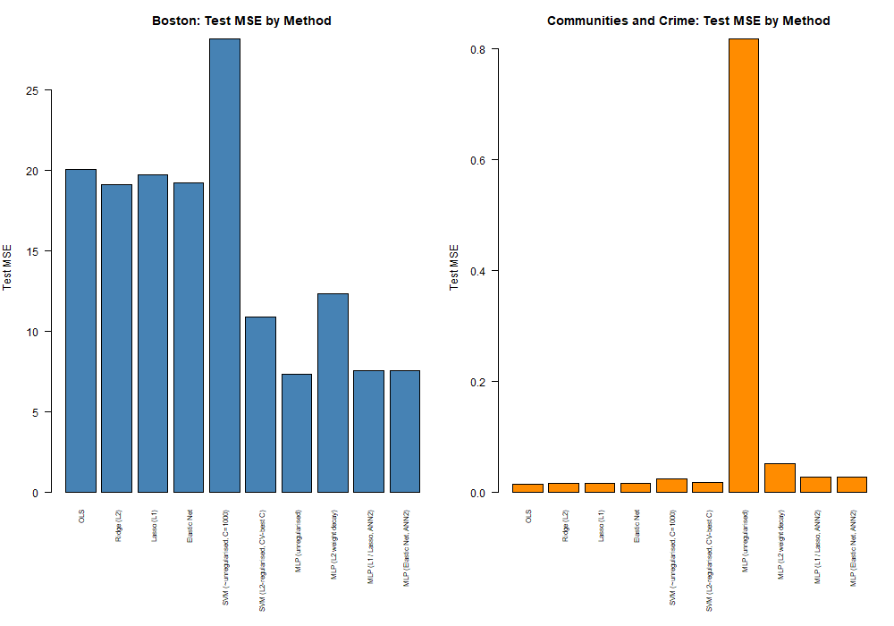</p>

**Why the results flip**
- **Boston** has 13 predictors and non-linear relationships. Flexible models like neural networks and a tuned SVM capture these, while linear models plateau at about 19 to 20.
- **Communities and Crime** has 100 predictors, many of them correlated. With that many inputs an unregularised network overfits badly, and linear models are already close to the best achievable error.

### Lasso variable selection

<p align="center">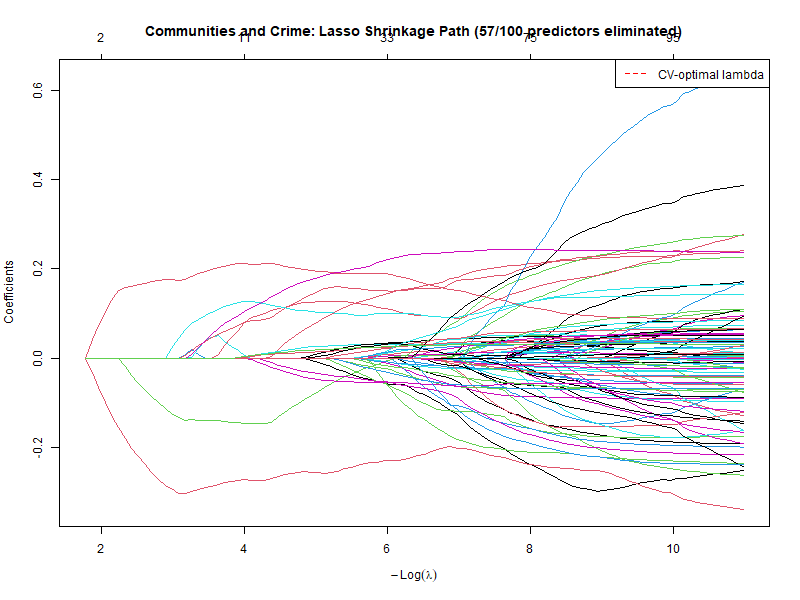</p>

As the penalty grows, coefficients shrink to exactly zero. At the CV-optimal penalty, 57 of the 100 predictors are dropped.

<details>
<summary><b>Boston Lasso path</b></summary>
<p align="center">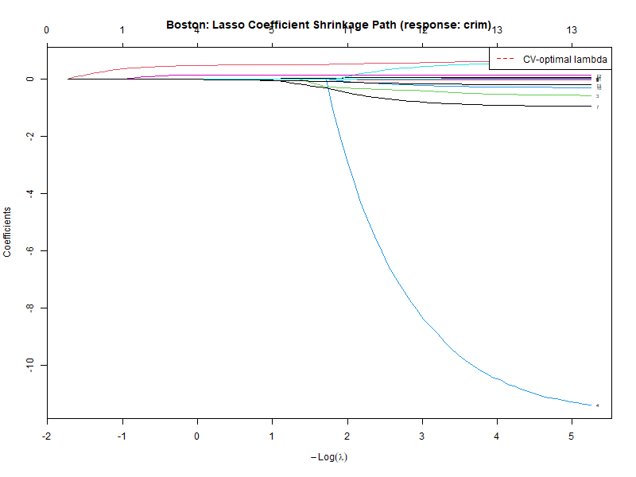</p>
</details>

### Training time

<p align="center">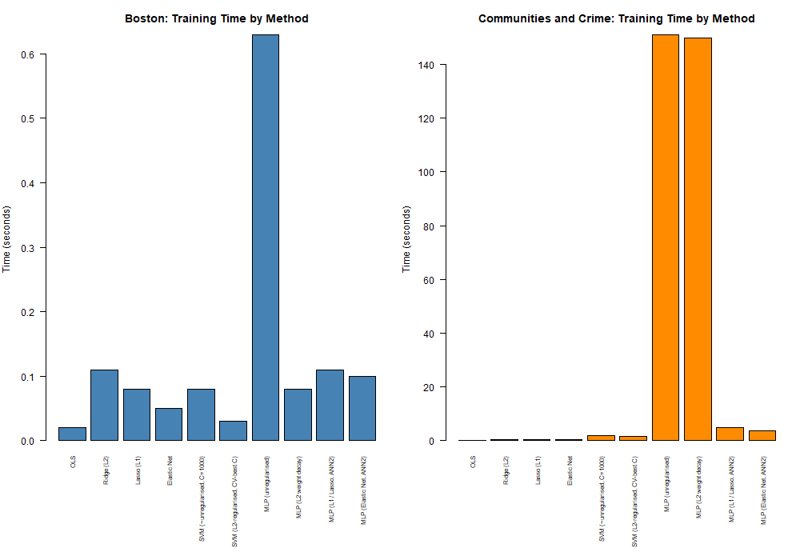</p>

On Communities and Crime, the two `nnet` models took about 150 seconds each, while the `ANN2` models took under 5. On Boston every model trained in under a second.

<details>
<summary><b>SVM: choosing the regularisation parameter C</b></summary>
<p align="center">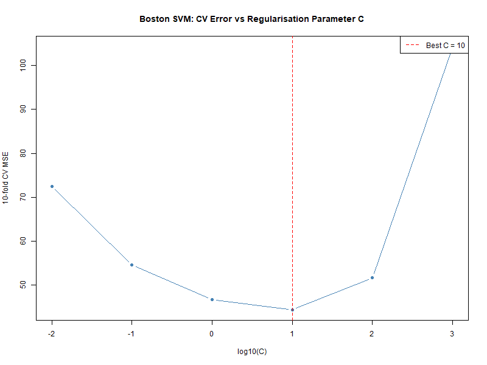</p>
<p align="center">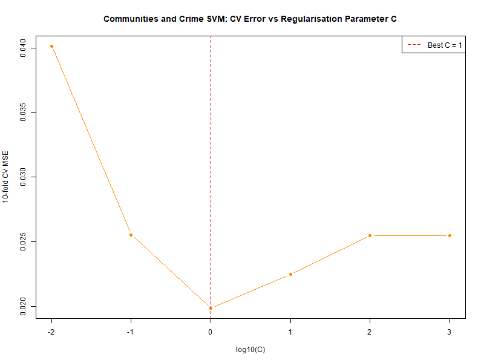</p>
</details>

<details>
<summary><b>Residual diagnostics</b></summary>

**Boston**
<p align="center">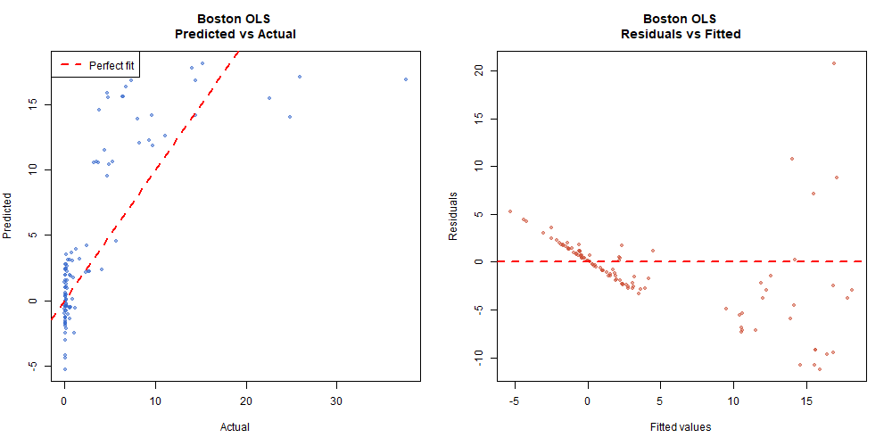</p>
<p align="center">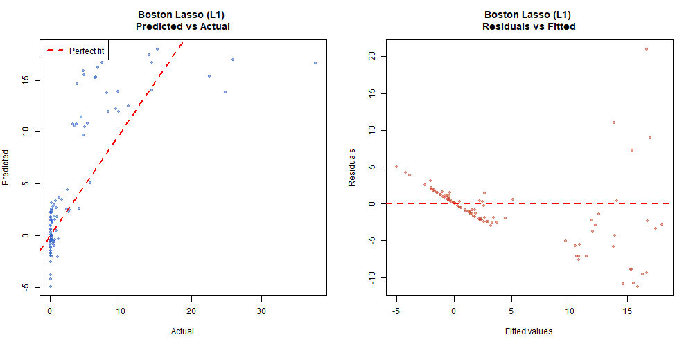</p>
<p align="center">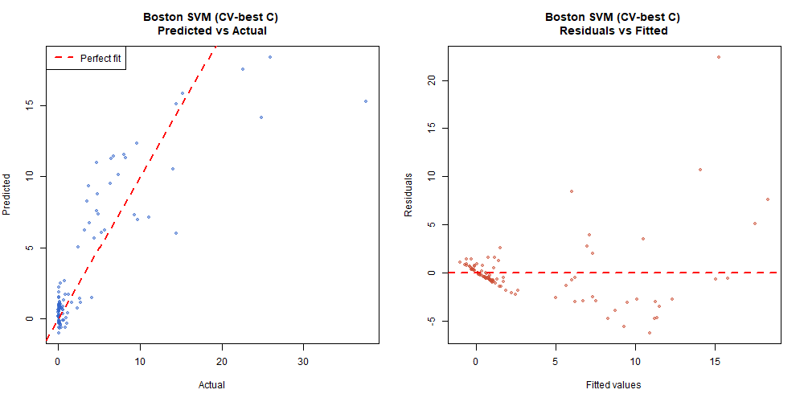</p>
<p align="center">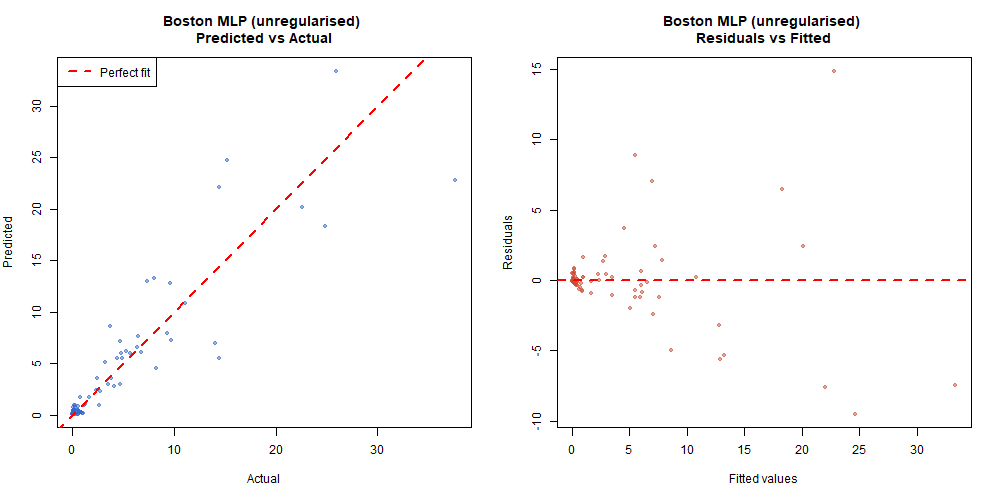</p>

**Communities and Crime**
<p align="center">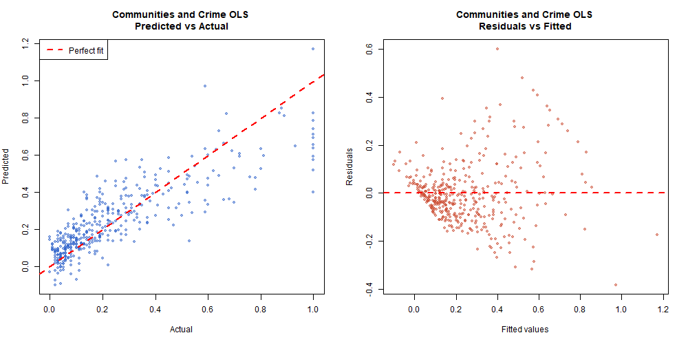</p>
<p align="center">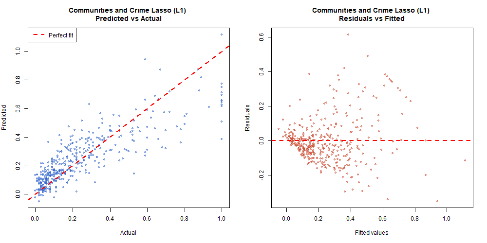</p>
<p align="center">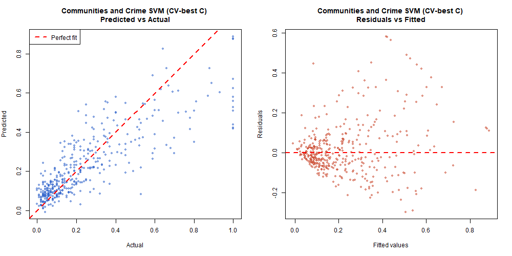</p>
<p align="center">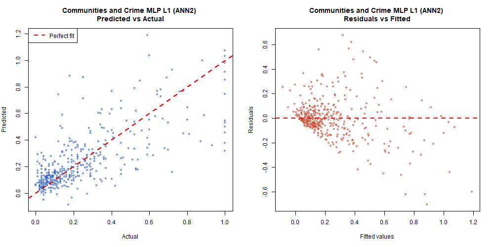</p>
</details>

---

## Data

Neither dataset is stored in this repository.

- **Boston** ships with the `MASS` R package and loads automatically.
- **Communities and Crime** is public on the [UCI Machine Learning Repository](https://archive.ics.uci.edu/dataset/183/communities+and+crime). Download `communities.data` and put it in the `data/` folder. See [`data/README.md`](data/README.md).

Cleaning for Communities and Crime: the 5 identifier columns (state, county, community, name, fold) are dropped, along with columns that are at least 50% missing (mostly policing variables). This leaves 1,993 rows and 100 predictors.

## Run it

```r
setwd("R")
source("plots.R")   # runs boston.R and crime.R, then writes the summary table and all charts
```

Missing packages (`MASS`, `glmnet`, `e1071`, `nnet`, `neuralnet`, `ANN2`, `sparseSVM`, `caret`, `dplyr`) are installed automatically by `utils.R`. The full run takes about 5 minutes, mostly the `nnet` models.

## Repository structure

```
crime-rate-prediction/
├── R/
│   ├── utils.R      Package setup and shared helpers (glmnet, SVM, residual plots)
│   ├── boston.R     All 10 models on Boston
│   ├── crime.R      All 10 models on Communities and Crime
│   └── plots.R      Summary table and diagnostic charts
├── data/            Data not included, see data/README.md
├── images/          Charts from the submitted run
├── docs/            R Markdown report (index.Rmd) and the knitted page (index.html)
└── results/         Test MSE and training time for every model
```

## Notes

- Completed for MIS41120 Statistical Learning at UCD Michael Smurfit Graduate Business School.
- Training times depend on hardware. Results can also vary slightly between runs because some cross-validation folds are drawn randomly.
- In this version, the Lasso predictor count no longer subtracts 1 for the intercept, which had made the printed count one too low (56 instead of 57). The charts and results are from the submitted run, and rerunning the code reproduces the same test errors.
- The number of predictors Lasso drops depends on the random cross-validation folds. With the seed used here it drops 57. With other fold assignments the CV-optimal penalty is weaker and it drops between 23 and 38, with similar test error.

---

**Sudarshan Ellora** · [Portfolio](https://www.sudarshanellora.com/) · [LinkedIn](https://linkedin.com/in/sudarshane) · [GitHub](https://github.com/sudarshanellora)
