```{r setup, include=FALSE}
knitr::opts_chunk$set(echo = FALSE, message = FALSE, warning = FALSE)

res <- read.csv("../results/results_summary.csv", stringsAsFactors = FALSE)
get <- function(ds, m, col = "Test_MSE") res[res$Dataset == ds & res$Method == m, col]

B  <- "Boston"; C <- "Communities and Crime"
b_ols   <- get(B, "OLS");              b_mlp  <- get(B, "MLP (unregularised)")
c_ols   <- get(C, "OLS");              c_las  <- get(C, "Lasso (L1)")
c_mlp   <- get(C, "MLP (unregularised)")
c_l1    <- get(C, "MLP (L1 / Lasso, ANN2)"); c_en <- get(C, "MLP (Elastic Net, ANN2)")
t_nnet  <- get(C, "MLP (unregularised)", "Execution_Time_Sec")
t_ann2  <- get(C, "MLP (L1 / Lasso, ANN2)", "Execution_Time_Sec")

pct  <- function(x) paste0(formatC(100 * x, format = "f", digits = 0), "%")
fmt  <- function(x, d) formatC(x, format = "f", digits = d, big.mark = ",")

mse_table <- function(ds, digits) {
  d <- res[res$Dataset == ds, c("Method", "Test_MSE", "Execution_Time_Sec")]
  best <- which.min(d$Test_MSE)
  d$Rank <- rank(d$Test_MSE)
  d$Test_MSE <- fmt(d$Test_MSE, digits)
  d$Execution_Time_Sec <- fmt(d$Execution_Time_Sec, 2)
  d$Method[best] <- paste0("**", d$Method[best], "**")
  d$Test_MSE[best] <- paste0("**", d$Test_MSE[best], "**")
  d <- d[order(d$Rank), c("Rank", "Method", "Test_MSE", "Execution_Time_Sec")]
  names(d) <- c("Rank", "Method", "Test MSE", "Training time (s)")
  knitr::kable(d, row.names = FALSE, align = c("c", "l", "r", "r"))
}
```

<style>
body { font-size: 16px; }
.key { display: flex; flex-wrap: wrap; gap: 12px; margin: 18px 0 26px; }
.key div { flex: 1 1 170px; border: 1px solid #dde3ea; border-radius: 8px; padding: 14px 16px; background: #f8fafc; }
.key b { display: block; font-size: 26px; color: #1f3864; }
.key span { font-size: 14px; color: #4a5568; }
img { max-width: 100%; height: auto; display: block; margin: 12px auto; }
</style>

## The question

Does the best model for predicting crime depend on how many predictors you have? The same 10 models were fitted to two datasets that differ mainly in dimensionality, then compared on test error and training time.

| Dataset | Rows | Predictors | Response |
|---|---|---|---|
| **Boston** (MASS) | 506 | 13 | `crim`, per capita crime rate |
| **Communities and Crime** (UCI) | 1,993 | 100 | `ViolentCrimesPerPop`, violent crimes per 100K population (scaled 0 to 1) |

## Key findings

<div class="key">
<div><b>57 of 100</b><span>predictors removed by Lasso, with test error within `r pct(c_las / c_ols - 1)` of OLS</span></div>
<div><b>`r pct(1 - b_mlp / b_ols)`</b><span>lower test error than OLS for the neural network on Boston</span></div>
<div><b>`r fmt(c_mlp / c_ols, 0)`x</b><span>worse than OLS for the unregularised neural network on Communities and Crime</span></div>
<div><b>`r floor(t_nnet / t_ann2)`x</b><span>faster neural network training after switching from nnet to ANN2</span></div>
</div>

- **The best model depends on the data.** Neural networks won on Boston. Simple linear models won on Communities and Crime.
- **Regularisation rescued the neural network.** L1 and Elastic Net penalties cut its error on Communities and Crime by about `r pct(1 - max(c_l1, c_en) / c_mlp)`.
- This is the No Free Lunch principle in practice: no single method is best everywhere.

## Models

| Family | Variants |
|---|---|
| Linear | OLS, Ridge (L2), Lasso (L1), Elastic Net |
| Support Vector Machine (radial kernel) | Nearly unregularised (C = 1000), L2-regularised with C picked by 10-fold CV |
| Multilayer Perceptron | Unregularised, L2 weight decay (`nnet`), L1 and Elastic Net (`ANN2`) |

**Method choices**

- 80/20 train/test split made before any fitting
- Scaling and class thresholds computed from the training set only, so nothing leaks from the test set
- Regularisation strength chosen by 10-fold cross-validation
- Fixed random seeds, and 5 random restarts for `nnet` to avoid poor local minima

## Results {.tabset}

The two datasets use different response scales, so compare methods within a dataset, not across.

### Boston

```{r}
mse_table(B, 2)
```

### Communities and Crime

```{r}
mse_table(C, 4)
```

### Both datasets

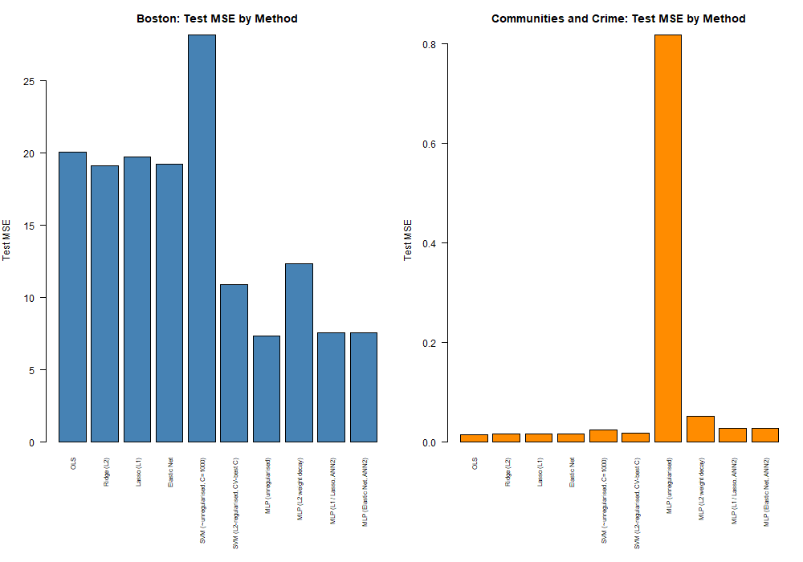

## Why the results flip

- **Boston** has 13 predictors and non-linear relationships. Flexible models like neural networks and a tuned SVM capture these, while linear models plateau at about 19 to 20.
- **Communities and Crime** has 100 predictors, many of them correlated. With that many inputs an unregularised network overfits badly, and linear models are already close to the best achievable error.

## Lasso variable selection {.tabset}

As the penalty grows, coefficients shrink to exactly zero. At the CV-optimal penalty, 57 of the 100 Communities and Crime predictors are dropped.

### Communities and Crime

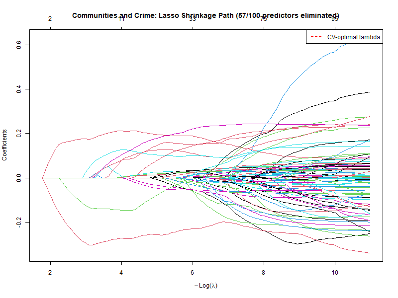

### Boston

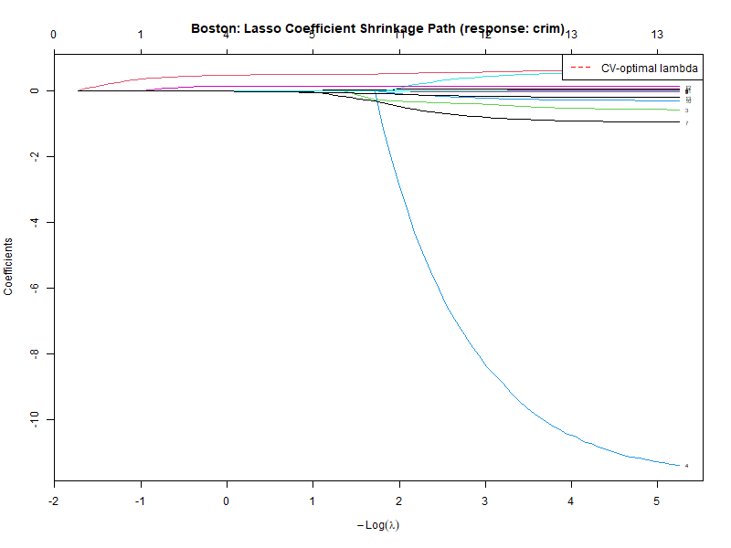

## Training time

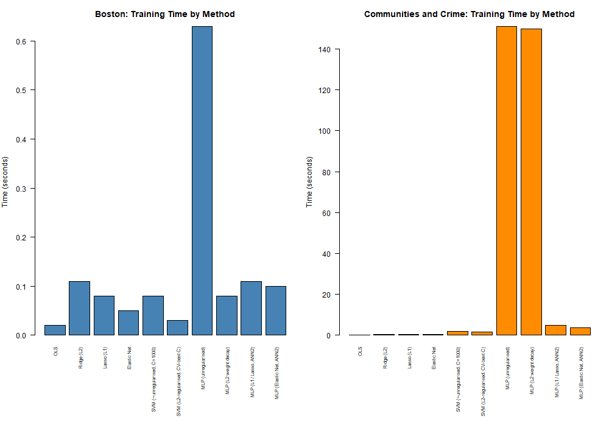

On Communities and Crime, the two `nnet` models took about `r fmt(t_nnet, 0)` seconds each, while the `ANN2` models took under 5. On Boston every model trained in under a second.

## SVM tuning {.tabset}

The regularisation parameter C was chosen by 10-fold cross-validation.

### Boston

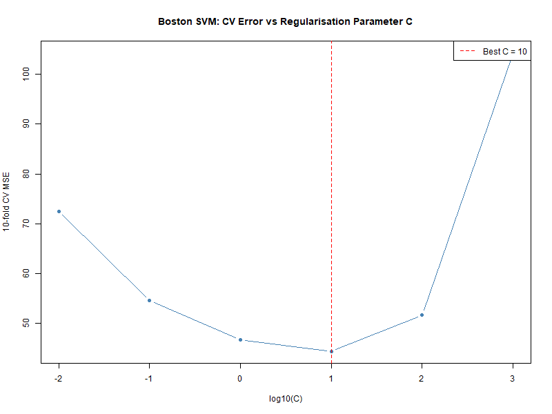

### Communities and Crime

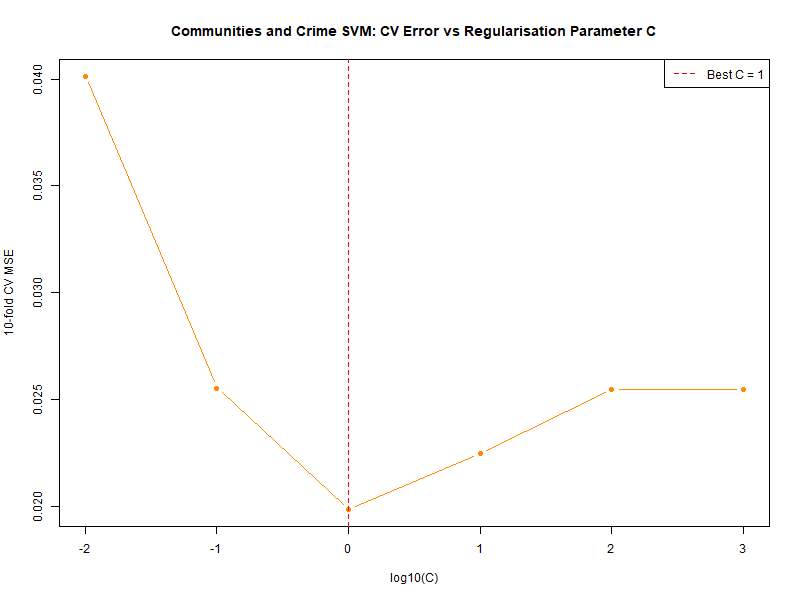

## Residual diagnostics {.tabset}

### Boston OLS
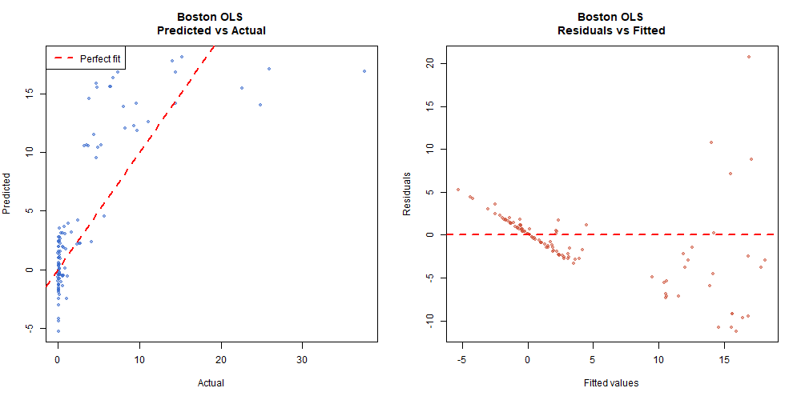

### Boston Lasso
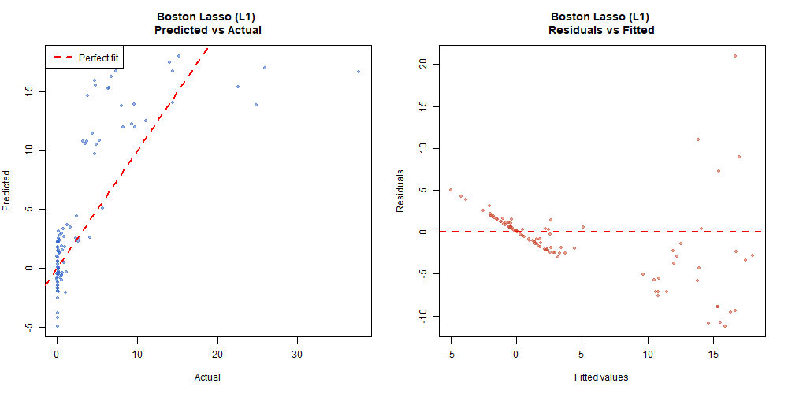

### Boston SVM
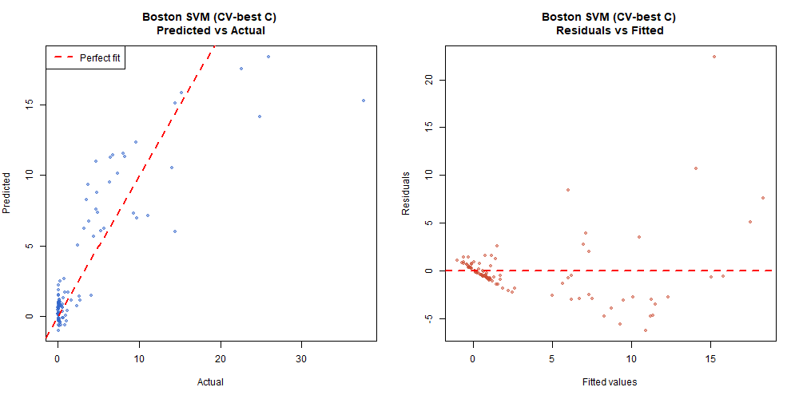

### Boston MLP
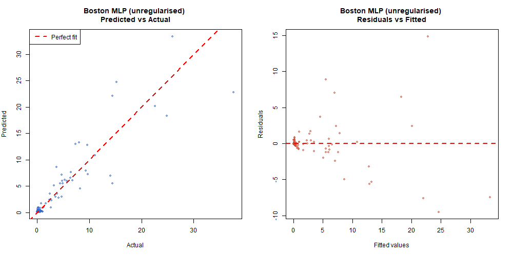

### Crime OLS
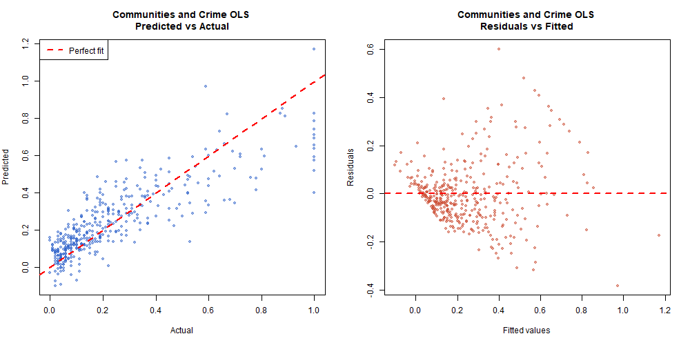

### Crime Lasso
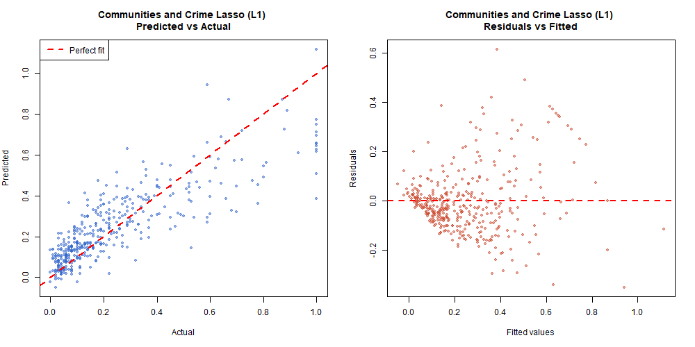

### Crime SVM
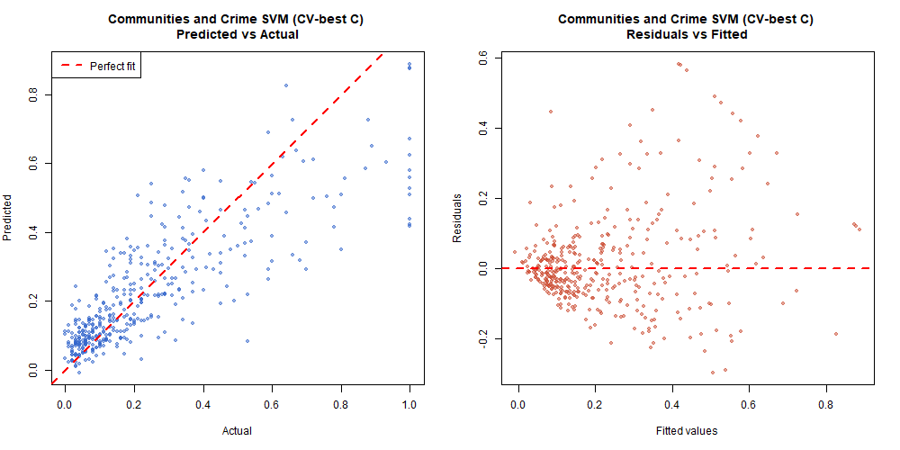

### Crime MLP
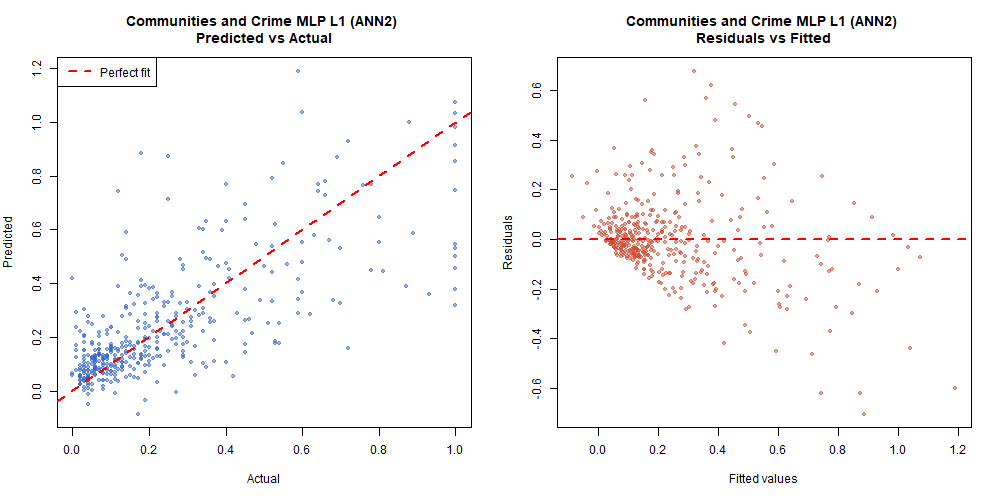

## Data and code

- **Boston** ships with the `MASS` R package.
- **Communities and Crime** is public on the [UCI Machine Learning Repository](https://archive.ics.uci.edu/dataset/183/communities+and+crime) (CC BY 4.0).
- Code, results and instructions: [github.com/sudarshanellora/crime-rate-prediction](https://github.com/sudarshanellora/crime-rate-prediction)

The number of predictors Lasso drops depends on the random cross-validation folds. With the seed used here it drops 57. With other fold assignments it drops between 23 and 38, with similar test error.

<hr>
<p style="font-size:14px;color:#4a5568">Completed for MIS41120 Statistical Learning at UCD Michael Smurfit Graduate Business School · <a href="https://www.sudarshanellora.com/">Portfolio</a> · <a href="https://linkedin.com/in/sudarshane">LinkedIn</a> · <a href="https://github.com/sudarshanellora">GitHub</a></p>
